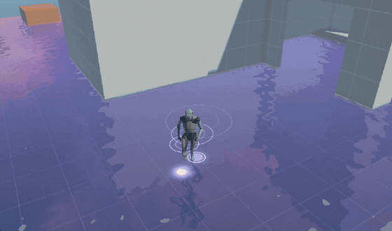
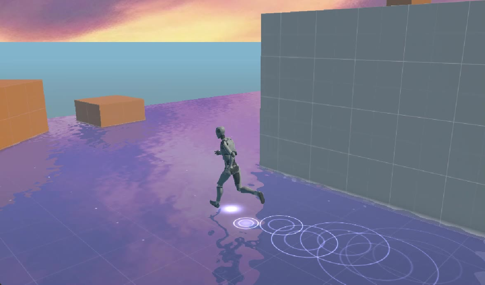

# Magic Water

A stylized, "magical" shallow water effect for URP. It works like a mirror, reflecting the sky and objects with a lavender tint, has twinkling blue sparkles, and spawns glowing ripple rings under the character's feet. Inspired by the reference clip `ref - magic water.mp4`. Everything is built from scratch in Shader Graph and C#, with no textures.

**Full recording:** [Docs~/magic-water-result.mp4](Docs~/magic-water-result.mp4) (24 s)

## What the effect does

| Element | How it works |
| --- | --- |
| Mirror reflection | A second camera renders the scene from a mirrored position below the water into `_MagicWaterReflectionTex`; the shader samples it in screen space. |
| Fresnel | The flatter you look at the water, the stronger the reflection. |
| Waves | Two Gradient Noise layers scrolling in different directions slightly distort the reflection. |
| Depth | Color blends from ShallowColor to DeepColor based on water depth (Scene Depth). |
| Edge | A toon-style bright line where objects intersect the water. |
| Sparkles | Voronoi cells, each with a random twinkle phase; HDR color + Bloom. |
| Footstep ripples | An emitter on the character stores the last 16 steps (position + time); an HLSL Custom Function draws expanding rings from them and uses them to bend the reflection. |

## Files

| File | Purpose |
| --- | --- |
| `MagicWater.shadergraph` | Water shader (Unlit, Transparent). |
| `MagicWater_graph_m.mat` | Material with the current settings. |
| `MagicWaterRipples.hlsl` | `MagicRipples` Custom Function: loops over the ripples. |
| `MagicWaterReflection.cs` | Planar reflection camera, added to the water object. |
| `MagicWaterRipples.cs` | Static buffer of 16 ripples sent to the shader as globals. |
| `MagicWaterRippleEmitter.cs` | On the character: spawns ripples on footsteps, with a gizmo for tuning. |
| `1 - magic water.unity` | Test scene. |

## Using it in another scene

1. A water plane on the **Water** layer, with the `MagicWater_graph_m` material and the `MagicWaterReflection` component.
2. `MagicWaterRippleEmitter` on the character, with the water assigned to the Water field.
3. In Third Person Controller, add **Water** to **Ground Layers**, otherwise the character gets stuck in the falling animation.
4. Main camera tagged **MainCamera** with Post Processing enabled, and a Global Volume with **Bloom** in the scene.
5. `PC_RPAsset` active (Depth Texture enabled). On `Mobile_RPAsset` depth and edge don't work.

## Current settings

| Group | Values |
| --- | --- |
| Reflection | MinReflection 0.61, ReflectionStrength 0.71, FresnelPower 2, Resolution Scale 1 |
| Waves | WaveScale 3, WaveSpeed 0.15, Distortion 0.05 |
| Sparkles | Density 1.11, Amount 0.43, Size 0.05, Speed 1, FadeDistance 40 m |
| Ripples (material) | Speed 1.5, Lifetime 0.8 s, Width 0.02, Distortion 0.03 |
| Ripples (emitter) | Step Distance 0.53, Foot Spacing 0.15, Forward Offset 0.3, Idle Interval 0 (off) |

## Known issues

- When looking steeply down at shallow water, gray edge patches appear (edge noise floods the shallow area). A smaller EdgeWidth (about 0.05) or deeper water helps.
- Distortion 0.05 makes the reflection noticeably choppy. The reference water is calmer, around 0.01–0.02.
- In the Scene view the reflection looks wrong because it shows the game camera's image. Judge the effect in the Game view.
- The reflection camera renders the scene a second time (without shadows and post-processing). In larger scenes, limit `Reflection Layers` or lower Resolution Scale to 0.5.
- Only one reflective water plane is supported at a time (the reflection texture is global).

## Next steps

- A custom Shader Graph skybox with an anime-style sunset gradient and clouds.
- A short particle burst on footsteps (Particle System or VFX Graph).
- Water color driven by time of day.
