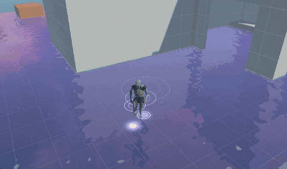

# Genshin-like

A Unity sandbox for recreating the stylized, anime-inspired look of open-world action RPGs in URP. Each visual effect lives in its own folder with a test scene and its own README, and is built from scratch in Shader Graph and C#.



## Features

| Feature | Status | Docs |
| --- | --- | --- |
| **Magic Water**: mirror-like shallow water with a lavender tint, twinkling sparkles and glowing footstep ripples | Done | [Assets/MagicWater/README.md](Assets/MagicWater/README.md) |
| **Skybox**: fantasy cubemap and panoramic skies (day, night, sunrise, sunset, rain, snow) | Imported | `Assets/Env/Fantasy Skybox FREE/Readme.txt` |
| **Character**: third-person controller with Cinemachine camera (Unity Starter Assets) | Imported | `Assets/Starter Assets/` |

Full recording of the water effect: [magic-water-result.mp4](Assets/MagicWater/Docs~/magic-water-result.mp4)

## Requirements

- **Unity 6000.3.25f1** (Unity 6.3)
- **Universal Render Pipeline 17.3.0**, with `PC_RPAsset` as the active pipeline asset (it has the Depth Texture enabled, which the water needs)
- Key packages: Input System 1.20, Cinemachine 3.1, ProBuilder 6.1, Splines 2.9, Timeline 1.8, AI Navigation 2.0

## Getting started

1. Clone the repository and open the folder in Unity Hub with Unity 6000.3.25f1.
2. Wait for the first import (the `Library` folder is rebuilt locally and not in git).
3. Open `Assets/MagicWater/1 - magic water.unity` and press Play.
4. Move with WASD, look around with the mouse, jump with Space, sprint with Shift. Walk into the water to see the ripples.

Judge the water in the **Game** view, because the Scene view shows the game camera's reflection from the wrong angle.

## Project structure

```
Assets/
├── MagicWater/                  Magic water effect (shader, scripts, test scene)
│   ├── Docs~/                   Preview GIF, screenshot and video (ignored by Unity)
│   └── README.md                Effect documentation and settings
├── Env/
│   └── Fantasy Skybox FREE/     Skybox materials and demo scenes (third-party)
├── Starter Assets/              Third/first-person controller and playground (Unity)
├── Scenes/SampleScene.unity     Default URP template scene
├── Settings/                    URP pipeline assets (PC / Mobile), renderers, volume profiles
├── TutorialInfo/                URP template readme (can be removed)
└── InputSystem_Actions.inputactions
Packages/                        Package manifest
ProjectSettings/                 Unity project settings
```

## Scenes

| Scene | Purpose |
| --- | --- |
| `Assets/MagicWater/1 - magic water.unity` | Test scene for the water effect, with the character and Bloom |
| `Assets/Starter Assets/Sample/ThirdPersonController/Playground.unity` | Starter Assets playground (third person) |
| `Assets/Starter Assets/Sample/FirstPersonController/Playground.unity` | Starter Assets playground (first person) |
| `Assets/Env/Fantasy Skybox FREE/Scenes/Demo with terrain.unity` | Skybox demo |
| `Assets/Scenes/SampleScene.unity` | URP template default (the only scene in Build Settings) |

## Conventions

- One folder per effect under `Assets/`, containing its shader, scripts, material, test scene and a `README.md`.
- Documentation media goes in a `Docs~/` subfolder: Unity ignores folders ending in `~`, so the files don't get imported as assets.
- Keep the **Water** layer for reflective water surfaces, and add it to the character's Ground Layers.

## Roadmap

- Custom Shader Graph skybox with an anime-style sunset gradient and clouds
- Particle burst on footsteps (Particle System or VFX Graph)
- Water color driven by time of day

## Third-party assets

- [Fantasy Skybox FREE](https://assetstore.unity.com/packages/2d/textures-materials/sky/fantasy-skybox-free-18353) from the Unity Asset Store
- [Starter Assets: Third Person](https://assetstore.unity.com/packages/essentials/starter-assets-thirdperson-updates-in-new-charactercontroller-pa-196526) by Unity Technologies

These assets are covered by the Unity Asset Store EULA.
